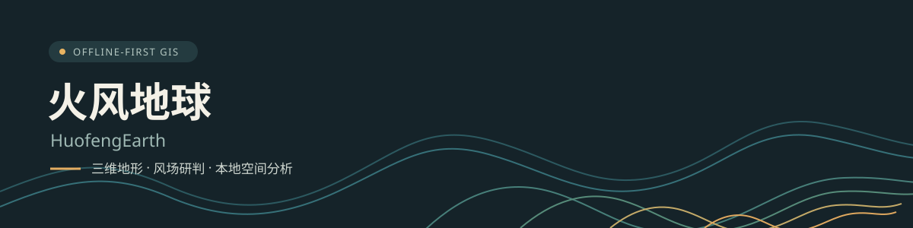

# 火风地球 · HuofengEarth

> 面向离线环境的三维地形、影像、风场与空间分析工作台。
>
> **v0.9.1-rc.1** · Windows 10/11 · 本地优先 · 用户数据不上传

[](https://github.com/maomao3334/huofeng-earth/actions/workflows/quality.yml)
[](LICENSE)
[](#快速开始)



HuofengEarth 是一个双击即可启动的本地三维地理应用。它把 Cesium 地球、精细地形、离线影像、Wind3D/WindNinja 结果、KML/KMZ、MBTiles 和常用空间分析工具放在一个可审计的本地工作台里。

这个仓库只发布软件源码和必要的第三方组件。地图、地形、影像、风场结果及其他业务数据不会进入 Git。应用支持离线、自动和在线工作模式；公开源码版不内置在线端点，部署者显式配置后才能读取在线地图瓦片，本地业务文件不会上传。

## 适合什么场景

- 内网、断网或受控环境中的三维地形查看与现场研判
- 风场结果的箭头、粒子、垂直廓线和高度切片展示
- KML/KMZ、GeoJSON、CSV、GeoTIFF、MBTiles 等本地文件的统一浏览
- 测距、测面积、高程剖面、标点、贴地绘制和出图
- 不希望把本地数据发送到第三方服务的桌面工作流

## 功能一览

| 三维地形 | 风场可视化 | 本地文件工作流 |
| --- | --- | --- |
| 分级加载、视角调度、贴地采样、地形夸张、2D/3D 切换 | 箭头、粒子、时间/高度场景、垂直风廓线、3D 高度切片 | KML/KMZ、GeoJSON、CSV、GeoTIFF、MBTiles、工程保存与恢复 |

| 空间分析 | 输出与共享 | 运行方式 |
| --- | --- | --- |
| 测距、测面积、累计爬升、净高差、高程剖面、标点和贴地绘制 | PNG、PDF、GeoJSON、KMZ、离线 HTML 快照 | Windows 启动器、浏览器模式、CLI、JavaScript API |

## 快速开始

### 从源码启动

```powershell
git clone https://github.com/maomao3334/huofeng-earth.git
cd huofeng-earth
.\start.cmd
```

打开命令行显示的本地地址，默认是 `http://127.0.0.1:8123/`。源码模式不需要前端打包步骤。没有运行数据时，应用可以启动，但地图图层需要由部署者提供。

### 指定端口

```powershell
powershell -NoProfile -ExecutionPolicy Bypass -File .\serve.ps1 -Port 8123
```

然后打开对应的本地回环地址。

### 编译 Windows 启动器

```powershell
powershell -NoProfile -ExecutionPolicy Bypass -File .\tools\build-launcher.ps1
```

需要 Windows 自带的 .NET Framework 编译器。脚本会在仓库根目录生成启动器；启动器和日志已加入忽略规则。源码位于 `packaging/`。

### CLI

```bat
maomaoearth.cmd check
maomaoearth.cmd serve --port 8123 --no-browser
maomaoearth.cmd stop
maomaoearth.cmd mbtiles "D:\path\to\map.mbtiles"
```

命令细节见 [docs/CLI.md](docs/CLI.md)。`maomaoearth.cmd` 和 `MaoMaoEarth` API 名称保留，用于兼容已有脚本；桌面产品名称为 HuofengEarth。

## 数据边界

本仓库采用软件与业务数据分离的发布方式。

- 不提交 DEM、影像、瓦片、风场结果、工程文件、日志、缓存或本机路径。
- 不提交任何用户提供的原始文件，也不把本地任务目录复制到仓库。
 离线与自动模式不依赖在线地图、CDN、在线字体或远程业务接口；选择在线模式后只请求地图瓦片。
- 数据包由部署者按自己的授权、保密和留存规则管理。
- 提交前应运行仓库中的 CI 检查，确认没有误加入 `data/`、`jobs/`、`out/`、`release/` 或二进制运行产物。

详细边界见 [DATA-POLICY.md](DATA-POLICY.md)。第三方软件许可见 [THIRD-PARTY-NOTICES.md](THIRD-PARTY-NOTICES.md)。

## 文档

- [JavaScript API](docs/API.md)
- [CLI 与启动器](docs/CLI.md)
- [绘制与贴地](docs/DRAW.md)
- [标点与工程数据](docs/MARKERS.md)
- [MBTiles](docs/MBTILES.md) · [MVT](docs/MVT.md)
- [Wind3D/WindNinja](docs/WIND3D-COMPUTE.md) · [风廓线](docs/WIND-PROFILE.md)

## 设计原则

HuofengEarth 的默认行为是本地优先、最小权限和可解释失败。服务只监听 `127.0.0.1`；离线与自动模式不请求外部服务，选择在线模式后才会读取在线地图瓦片，不上传本地业务文件。地图、地形和风场的显示结果取决于部署者提供的运行数据，不能替代测绘、导航、工程设计或安全决策所需的法定数据。

## 开源许可

本项目代码以 [MIT License](LICENSE) 发布。`vendor/` 中的第三方组件保留其原始版权与许可；再分发时请同时阅读 [THIRD-PARTY-NOTICES.md](THIRD-PARTY-NOTICES.md)。

欢迎提交可复现的代码问题、性能数据和改进建议。请勿在 Issue、Pull Request 或日志附件中上传业务数据、原始地形、影像或带坐标的敏感文件，提交规范见 [CONTRIBUTING.md](CONTRIBUTING.md)。
